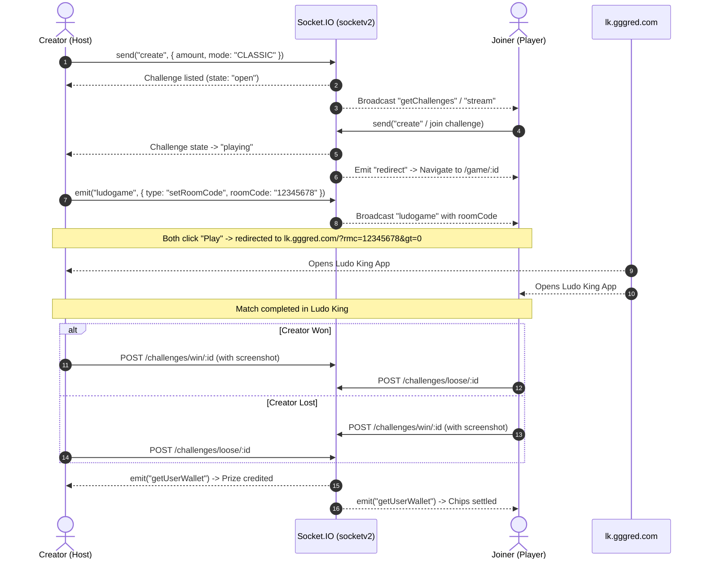

# Friend Ludo (friendludo.com) — Reverse Engineering Analysis & Protocol Specification

This document details the reverse-engineered client architecture, API contracts, WebSocket communication protocols, and match lifecycle of **Friend Ludo** (`friendludo.com`).

---

## 1. System Architecture & Tech Stack

| Component | Implementation |
| :--- | :--- |
| **Frontend Framework** | React 18 (Create React App / Webpack bundle), React-Bootstrap, Redux Toolkit |
| **Styling** | Bootstrap 5.3 + Custom CSS theme with Dark/Light mode support |
| **Deployment Mode** | Progressive Web App (PWA) with maskable icons and standalone display |
| **Backend REST API** | `https://apiv2.friendludo.com/api` |
| **Realtime Engine** | Socket.IO `v3/v4` (`https://socketv2.friendludo.com/`) |
| **Payment Gateway** | UPI Gateway integration (`https://merchant.upigateway.com/api/create_order`) |
| **Deep Link Engine** | `https://lk.gggred.com/?rmc={roomCode}&gt=0` (one-click Ludo King room code launch) |
| **Support Channels** | Telegram (`@friendludo1`) and WhatsApp direct chat |

---

## 2. Authentication & Client Session Architecture

Friend Ludo relies on cookie-based JWT session storage:

- **Token Storage**: Saved via `js-cookie` into browser cookies:
  - `token`: JWT Bearer Token (`expires: 365 days`)
  - `fullName`: Display name
  - `userId`: MongoDB Object ID of the authenticated user
- **API Authorization**:
  - `Authorization: <jwt_token>` header on all protected HTTP requests to `apiv2.friendludo.com/api`.

### Authentication Endpoints
- **`POST /api/auth/signup`**: User registration with Phone, Full Name, and optional Referral Code.
- **`POST /api/auth/login`**: User login with phone number.
- **`POST /api/auth/OTP`**: Requests a 6-digit SMS OTP.
- **`POST /api/auth/confirmOTP`**:
  - **Payload**: `{ phone: "9876543210", otp: "123456" }`
  - **Response**: `{ status: 200, data: { jwtToken: { jwtToken: "..." }, fullName: "...", userId: "..." } }`
- **`POST /api/auth/resendOTP`**: Resends OTP if timer expires.
- **`POST /api/auth/logout`**: Inactivates current session token.

---

## 3. Real-Time Socket.IO Protocol Specification

Friend Ludo connects to:
`https://socketv2.friendludo.com/`

Options:
```javascript
const socket = io("https://socketv2.friendludo.com/", {
  autoConnect: true,
  reconnection: true,
  reconnectionDelay: 5000,
  reconnectionAttempts: 20,
  forceNew: true
});
```

### 3.1 Client -> Server Commands

#### 1. Create a Match Lobby
```javascript
socket.send(JSON.stringify({
  type: "create",
  payload: {
    amount: 100,            // Min: 10, Max: 25000
    userId: "<USER_ID>",
    username: "<USERNAME>",
    mode: "CLASSIC"         // "CLASSIC" (>= 50 & %50==0) or "POPULAR" (<= 49 & %5==0)
  }
}));
```

#### 2. Request Open & Running Challenges
```javascript
socket.send(JSON.stringify({
  type: "getChallenges",
  payload: {
    userId: "<USER_ID>"
  }
}));
```

#### 3. Delete Host's Open Lobby
```javascript
socket.send(JSON.stringify({
  type: "deleteOpenChallengesOfCreator",
  payload: {
    userId: "<USER_ID>"
  }
}));
```

#### 4. Heartbeat Keep-Alive (Ping/Pong)
When server sends `{ type: "heartbeat" }`, client must respond:
```javascript
socket.send(JSON.stringify({ type: "ack" }));
```

#### 5. Fetch Match Details by Challenge ID
```javascript
socket.emit("ludogame", JSON.stringify({
  type: "getChallengeByChallengeId",
  payload: {
    challengeId: "<CHALLENGE_ID>",
    userId: "<USER_ID>"
  }
}));
```

#### 6. Submit Ludo King Room Code (Host Only)
```javascript
socket.emit("ludogame", JSON.stringify({
  type: "setRoomCode",
  payload: {
    userId: "<USER_ID>",
    ChallengeId: "<CHALLENGE_ID>",
    roomCode: "12345678"     // Must be exactly 8 digits
  }
}));
```

#### 7. Fetch Live Wallet Balance
```javascript
socket.emit("getUserWallet", JSON.stringify({
  payload: {
    userId: "<USER_ID>"
  }
}));
```

#### 8. Request Global Settings
```javascript
socket.emit("message", JSON.stringify({
  type: "getSettings",
  payload: {
    userId: "<USER_ID>"
  }
}));
```

---

### 3.2 Server -> Client Events

| Socket Event | Payload & Function |
| :--- | :--- |
| `getChallenges` | Complete list of all open, requested, and playing matches in the lobby. |
| `stream` | Real-time update for a single challenge (status changes: `open` -> `requested` -> `playing`). |
| `deleteChallenge` | Emitted when a challenge is deleted by creator or expires. |
| `redirect` | Triggers client redirection to `/game/:challengeId` when opponent joins. |
| `ludogame` | Live game state containing `roomCode`, `creator`, `player`, and match amounts. |
| `getUserWallet` | Real-time chip balance update. |
| `paymentStatus` | Instant notification when a deposit transaction succeeds or fails. |
| `settings` | Updates site maintenance mode, banner carousels, and min/max limits. |

---

## 4. Complete REST API Surface

### 4.1 User & KYC Endpoints
- **`GET /api/user/getUserProfileData`**: Full user profile, total wins, total games, wallet balance.
- **`POST /api/user/updateUserProfile`**: Update profile picture, username, or contact info.
- **`POST /api/user/kycRegister`**: Submit Aadhaar number for KYC.
- **`POST /api/user/kycOtp`**: Verify OTP received from UIDAI.
- **`POST /api/user/manualkyc`**: Upload physical PAN and Aadhaar card photos for manual approval.
- **`GET /api/user/kycDetails`**: Current KYC review status (`pending`, `verified`, `rejected`).
- **`GET /api/user/AllBanks`**: User's saved bank accounts.
- **`GET /api/user/AllUpiBanks`**: User's saved UPI IDs.
- **`POST /api/user/verify/ifsc`**: Validates bank IFSC code.

### 4.2 Cashier (Buy Chips & Sell Chips)
- **`POST /api/transaction/buy-link`**: Generates payment gateway URL via `merchant.upigateway.com`.
- **`POST /api/transaction/buy-manual`**: Submits manual UTR screenshot for offline QR deposits.
- **`POST /api/transaction/upi-sell`**: Withdrawal request to a verified UPI ID.
- **`POST /api/transaction/bank-sell`**: Withdrawal request to a verified Bank Account (IMPS/NEFT).
- **`POST /api/transaction/upi-delete`**: Deletes a saved UPI destination.
- **`POST /api/transaction/bank-delete`**: Deletes a saved Bank account.
- **`POST /api/transaction/verify-vpa`**: Validates UPI VPA address.
- **`GET /api/transaction/wallet`**: Returns detailed ledger (Deposit chips, Win chips, Bonus chips).

### 4.3 Match Result & Disputes
- **`POST /api/challenges/win/:challengeId`**: Uploads result screenshot and registers victory.
- **`POST /api/challenges/loose/:challengeId`**: Concedes match (`{ createdAt: new Date() }`).
- **`POST /api/challenges/cancel/:challengeId`**: Submits match cancellation request if opponent fails to provide room code.

---

## 5. Match Lifecycle State Flow


